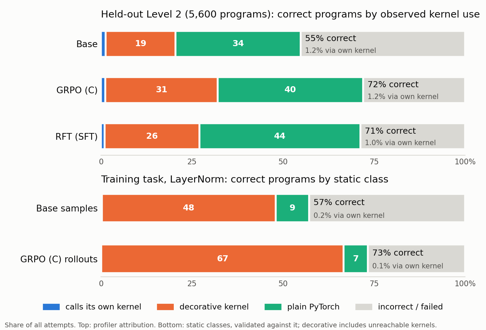

# Correct, But Not Kernels

### RL on a permissive verifier raised Gemma 4's correctness, not its kernel writing

## Abstract

Verifiable rewards are the standard recipe for post-training coding agents. We apply
it to KernelBench GPU-kernel tasks with Gemma-4-12B-it, GRPO [11] and LoRA [12], under
a hardened verifier that checks numerical correctness on fresh inputs but, like most
test suites, accepts any passing implementation, including plain PyTorch. Training on
one Level-1 task raises Level-2 numerical correctness from 54.9% to 72.0% (+17.1
points, 98.3% CI [12.6, 21.8]; three seeds, 9,600 programs). The gain replicates on a
consumer RTX 5070 Ti and is matched by rejection-sampled SFT (C − SFT +0.75 [−2.0, 3.6]).
Profiler-based replay of 5,600 Level-2 programs shows that the share that is correct
*and* launches a model-written kernel is unchanged (−0.04 points [−0.75, 0.58]). The
gain comes from plain PyTorch (+5.5) and *decorative kernels* (+11.6): kernels defined
but never called, a failure recent kernel-RL systems filter at reward time; we measure
it with the filter off. On the training task decorative programs pass 80% of the time
and programs that call their own kernel pass 2 times in 39, so the reward pays for
decoration, and SFT's filtered data is 81% decorative. On issue-style repair of two
real Liger-Kernel defects, the fine-tuned checkpoints resolve 0 of 72 attempts. In two
public corpora (34,621 kernels), decoration is rare but vendor delegation is common.
We release the contract, classifiers, scripts and receipts.

## 1. Introduction

Coding agents are increasingly post-trained against executable verifiers: unit tests
for SWE tasks, reference comparisons for numerical code. The verifier is a proxy for
what the developer wants, and RL learns whatever the gap between the two allows.
Discussion of this gap usually concerns *exploits*: constant outputs, test tampering,
timing games. Recent kernel-RL systems also guard against correct programs that never
run their own kernel [14, 15], but they train with the guard on. We ask the
counterfactual: without it, what is a replicated correctness gain made of?

Each KernelBench task gives a PyTorch reference module; the policy must return a
`ModelNew` that is correct and faster than eager PyTorch. Our prompt asks the model
to "prefer a custom Triton or CUDA kernel" but, following KernelBench, also says
"PyTorch operations remain allowed where they are useful". The verifier enforced
correctness rigorously (Section 3.1) but did not require a custom kernel to run.

Contributions:

1. **A replicated gain with a negative control.** GRPO on one task raises held-out
   Level-2 correctness by ~17 points (three seeds, two GPUs); RFT matches it.
2. **A mechanism decomposition.** Profiler-based attribution splits the gain into
   plain PyTorch, decorative and launched kernels; only the last reflects
   kernel-writing, and it does not move.
3. **Training dynamics.** A static classifier, validated against traces (1,519/1,519
   agreement on "never called"), reads the 1,720 GRPO rollouts and RFT data and shows
   that the reward itself selects decoration.
4. **A SWE-shaped transfer test.** On issue-style repair of real repository kernels,
   where the kernel must run, the gain disappears (0/72 resolved after fine-tuning).
5. **Public corpora.** In the AI CUDA Engineer archive and KernelBook, decoration is
   rare; most Level-2/3 "faster" kernels run their GEMM or convolution in cuDNN/cuBLAS.

## 2. Related Work

**Kernel generation and RL.** KernelBench [1] defines PyTorch-to-kernel tasks. Kevin
[2] trains multi-turn RL for CUDA and zeroes the reward for `try/except` fallbacks and
`torch.nn` calls; CUDA-L1 [3] uses contrastive RL. AutoTriton [13] requires Triton
syntax. TritonRL [14] adds call-level linting and an LLM judge; without them
AutoTriton's Level-2 correctness rises from 1% to 94%. Dr. Kernel [15] instruments
Triton launches and rejects programs that execute none, including emitted-but-unused
kernels; with the check on, this hacking falls from ~20% to ~3% during RL. Hari et al.
[16] drop attempts whose profile shows only library kernels.

**Verifier robustness.** robust-kbench [4] adds varied initialization and
profiler checks; KernelBench-Verified [5] exposes hardcoded bypasses with hidden
test distributions. Both target *exploits*, instances of reward hacking [6].
Decorative kernels are thus a known failure with a known remedy. What prior work does not report is a
controlled measurement with the remedy absent: how much of a replicated gain they
account for, how their share moves during training, and whether RL and RFT differ.

**Does RL add capability?** Yue et al. [7] find that RL with verifiable rewards
mostly re-weights solutions the base model already samples; RFT [8, 9] is the natural
control, and our results are a code-execution instance of that view.

**SWE agents.** SWE-bench [10] scores patches with repository tests; Section 4.4
uses the same issue-plus-hidden-tests shape on kernel code.

## 3. Methods

### 3.1 Environment and verifier

Tasks come from KernelBench at a pinned, hash-locked revision. The split was fixed
before any evaluation, and all 100 Level-2 tasks are held out. A program is one
Python file that may embed CUDA C++ or Triton; it runs in a sandbox with no network,
a read-only filesystem and resource caps. Correctness uses harness-controlled fresh
inputs (rtol 1e-3, atol 1e-4, finite outputs) and checks output storage ownership and
input reuse or mutation. Timing uses CUDA events with L2 flush. Gated controls
verified isolation, timing stability (CV across 30 median estimates 0.0145%) and
robustness: four cheats that pass a naive checker (precomputed outputs, input
aliasing, side-stream timing evasion, default-distribution-only correctness) were
rejected.

### 3.2 Policies

The base policy is `google/gemma-4-12B-it` (temperature 1.0, top_p 0.95, top_k 64;
the reasoning channel is stripped before code extraction). All fine-tuning uses LoRA
(rank 16, α 32) on **one** task, `level1/40_LayerNorm`. It was the only screened task with a mixed base pass rate,
which GRPO needs for a learning signal.

- **C:** GRPO, group size 8, 40 steps, lr 1e-5, KL β 0.01, 4,096-token completions;
  reward 1 if correct, 0 if incorrect, −0.1 for crash or format failure.
- **S:** as C, but a correct program scores s/(1+s) for speedup s and failures score
  0, so it is not a clean speed ablation. One S
  seed was stopped at step 15 by a pre-declared detector kill criterion.
- **SFT (RFT):** 320 base samples per seed on the same task. Correct samples with
  natural stops are kept (171/177/200 per seed). The learning rate was chosen from
  three values on train-task validation.

Each arm has three training seeds and pre-declared kill criteria.

### 3.3 Evaluation

Each policy generates 8 programs for each of 100 Level-2 and 20 held-out Level-1
tasks. The primary endpoint is Level-2 numerical correctness. Seeds are averaged
within task, and the shared base evaluation counts once. Intervals are task-level
percentile bootstraps, Bonferroni-adjusted (98.33%) for the three pre-specified
comparisons unless marked otherwise. They are conditional on these checkpoints and
tasks.

### 3.4 Mechanism replay and static classifier

We re-executed the 5,600 saved Level-2 programs (base and six C/SFT checkpoints),
recording ATen dispatch and executed CUDA kernels (PyTorch profiler) in the forward
pass. Declared kernels are `@triton.jit` functions and `__global__` functions in CUDA
strings. A program is **plain PyTorch** (no declared kernel), **decorative** (declared,
none executed) or **launched** (a declared kernel executed, possibly alongside ATen).
A strict contract additionally forbids any high-level ATen compute; since most Level-2
tasks contain a convolution or GEMM, this bar is deliberately severe.

Training rollouts have no traces, so a static classifier checks whether each declared
kernel's name occurs only at its definition, or is reachable from `ModelNew`. On the
replay, all 1,519 "definition only" programs were observed not to launch, and 90 of
102 "reachable" programs were observed to launch.

## 4. Results

### 4.1 Fine-tuning raises numerical correctness, and RL ≈ RFT

| Policy (Level 2, 100 tasks × 8) | Correctness |
|---|---:|
| Base | 54.875% |
| C (GRPO), 3 seeds | 72.000% |
| S (speed-shaped), 3 seeds | 71.667% |
| SFT (RFT), 3 seeds | 71.250% |

| Comparison | Δ (points) | 98.33% CI |
|---|---:|---|
| C − base | +17.125 | [12.625, 21.792] |
| S − base | +16.792 | [12.333, 21.417] |
| C − SFT | +0.750 | [−1.958, 3.583] |

RFT captures essentially all of the RL gain; the interval does not establish
equivalence. Speed did not improve: on programs both policies solve, per-seed
geometric-mean speed ratios against base lie between 0.988 and 1.011 for every arm.

**Consumer-GPU replication.** On a 16 GB RTX 5070 Ti (78 tasks passed pre-frozen
resource checks; the other 22 hit preset storage limits), replay over 4,368 attempts
gives base 54.01%, C 71.69%, SFT 71.47%; C − base +17.68 [12.39, 23.13]; C − SFT +0.21
[−2.88, 3.47]. Both GPUs are Blackwell, so this is a platform, not an architecture,
replication.

### 4.2 Where the gain comes from

*Figure 1. Correct programs by kernel use, on held-out tasks (top) and the training
task (bottom).*

Under the strict contract, 0 of 5,600 programs are both correct and compliant. The
graded decomposition, as shares of all attempts (95% task bootstrap, unadjusted):

| Δ share of attempts | C − base | SFT − base | C − SFT |
|---|---:|---:|---:|
| **Correct, total** | **+17.12** [13.42, 20.92] | **+16.38** [12.83, 20.04] | +0.75 [−1.50, 3.04] |
| Correct, plain PyTorch | +5.54 [2.83, 8.25] | +9.83 [6.46, 13.29] | −4.29 [−6.83, −1.83] |
| Correct, decorative | +11.62 [8.38, 14.96] | +6.83 [3.46, 10.25] | +4.79 [2.21, 7.33] |
| Correct, launched | −0.04 [−0.75, 0.58] | −0.29 [−1.17, 0.42] | +0.25 [−0.33, 0.92] |

Correct programs that launch their own kernel are rare under every policy: base
10/439, C 29/1,728, SFT 23/1,710. All 62 still run the convolution or GEMM in ATen,
and the model's kernel handles an elementwise or reduction epilogue (a median of
one in three kernel launches). This is partial fusion, and training
does not make it more common.

Among decorative correct programs, the kernel's name occurs only at its definition
in 141/154 (base), 660/741 (C) and 566/626 (SFT) cases. A typical C program for `Conv2d_GroupNorm_Scale_MaxPool_Clamp` defines a fused Triton
kernel, then calls `self.conv`, `self.group_norm`, `torch.clamp` and `self.maxpool`.

### 4.3 The training signal selects decoration

On the training task the base model already writes decorative LayerNorm programs:
a Triton kernel, then `nn.LayerNorm`. These pass far more often than real attempts.
Base samples and rollouts share the prompt, sampling settings and one-check scorer:

| LayerNorm, static class | Base samples (960) | GRPO-C, steps 1–40 (936) | RFT data (548) |
|---|---|---|---|
| Decorative (definition only) | 58%; **80% pass** | 73%; 88% pass | 81% |
| Plain PyTorch | 28%; 33% pass | 11%; 59% pass | 16% |
| Calls its own kernel | 4%; **5% pass (2/39)** | 5%; 2% pass (1/45) | 0.4% |

During RL a real kernel almost never earned reward, and decoration usually did: GRPO
raised the decorative share from 58% to 73%. Plain-PyTorch programs also gesture at
Triton: in one seed's 320 base samples, 58 of the 63 plain-PyTorch crashes call Triton
attributes that do not exist. Both methods learned "write a kernel, call
`nn.LayerNorm`". The SFT data is the more decorative, so data composition does not
explain the C − SFT difference in Section 4.2; we leave its cause open.

### 4.4 Does the gain transfer to issue-style repair?

A SWE agent edits existing code to resolve an issue. We gave the base model and the
six C/SFT checkpoints two defects reduced from Liger-Kernel pull requests #1490
and #1461. Each prompt holds an issue-style description and the buggy Triton
source; the pull request, its fix and the withheld tests are hidden. A patch resolves
the issue only if it passes visible and withheld tests under the strict contract.
Each policy made 12 single-shot attempts (2 defects × 3 feedback forms × 2 replicates).

| Repair attempts | Resolved | Wrong, contract-compliant | Contract violation |
|---|---:|---:|---:|
| Base | 2/12 | 7 | 0 |
| C, 3 checkpoints | 0/36 | 19 | 1 |
| SFT, 3 checkpoints | 0/36 | 23 | 2 |

The benchmark gain does not transfer. Both base successes are one defect under one
feedback form, so this shows no transfer, not harm. Nor does the shortcut appear: no
attempt passed by bypassing the kernel, and the three violations are host-side
`.contiguous()` calls in wrong programs. When the task starts from an existing kernel
that must run, the skill gap is exposed rather than hidden.

Iterative repair (up to four attempts with visible feedback) resolved 2/12 episodes with
base Gemma-4-12B-it and 7/12 with Gemma-4-31B-it (2/4, 2/4 and 3/4 across feedback
forms), from only three distinct successful programs. One computes tanh as
`(eˣ−e⁻ˣ)/(eˣ+e⁻ˣ)`; on GPU it is correct at |x| ≤ 88 but non-finite on every row with
|x| ≥ 89 in float32, float16 and bfloat16.

### 4.5 Public kernel corpora

We applied analogous static classes to two public
corpora: the AI CUDA Engineer archive [17] (16,459 CUDA kernels its harness marked
correct) and KernelBook [18] (18,162 PyTorch-to-Triton pairs generated by TorchInductor,
the SFT data behind KernelLLM). For the archive, a static check for host-side GEMM or
convolution calls agrees with library compute in the archive's own profiles on 98%,
99% and 90% of Level 1–3 kernels. Hari et al. [16] reviewed the best archive kernel per
problem (3 of 57 PyTorch-only); we classify every correct kernel.

| Correct kernels | Decorative | No custom kernel | GEMM/conv in a library |
|---|---:|---:|---:|
| AI CUDA Engineer, L1 (7,222) | 12 | 42 | 149 |
| AI CUDA Engineer, L2 (6,988) | 13 | 97 | 3,433 |
| AI CUDA Engineer, L3 (2,249) | 43 | 406 | 1,883 |
| KernelBook (18,162) | 0 | 0 | 10,749 |

Decoration is rare in both corpora; in our data it came from samples filtered only by
a permissive verifier. Level-1 kernels, single operators, are mostly genuine (7,051 of
7,222 launch a custom kernel and call no library GEMM/conv). Fused tasks differ. On
Level 2, 2,734 of the 4,750 archive kernels reported faster than eager PyTorch run
their GEMM or convolution in cuDNN/cuBLAS; in 2,689 the custom kernel handles only the
remaining operations, like our 62 launched programs. On Level 3, 296 of 1,161 "faster"
kernels launch no custom kernel.

## 5. Discussion

**Why RL ≈ RFT here.** The highest-reward behaviour (decoration plus vendor
operators) is already the base model's most common successful output.
GRPO re-weights it and RFT copies it; correct kernel-calling programs were too rare
(1 of 45 kernel-calling rollouts passed) for exploration to amplify.

**What a stricter reward needs.** A launch check [15] would remove decoration, but
in our setting it would also remove nearly all signal. Only 2 of 960 base LayerNorm
samples call their own kernel and pass, so a GRPO group of 8 contains any success
with probability ≈1.7%. Systems that train with such checks first fine-tune on
curated kernel data [13–15]; our numbers show why.

**Why source checks mislead.** Of 960 base LayerNorm samples, 613 define a
`@triton.jit` kernel and 39 call it, so syntax checks [13] overstate kernel use;
call-level lints [14], launch traces [15] or a validated reachability check do not.

**For SWE agents.** A test-passing gain is not a repair skill: checkpoints that gained
17 points resolved no issue-style repairs (Section 4.4). Requirements that matter
("use a kernel", "fix the root cause") must be measured directly.

**Limitations.** (i) One training task. (ii) Level-2 tasks were seen in pilots, so this
is a fresh-sample confirmation on known tasks. (iii) The replay is retrospective; a
36-program strict-prompt pilot had 0 successes, and no large strict-prompt generation
was run. (iv) "Launched" uses name attribution; training-time and corpus analyses are
static and validated against traces or logged profiles.
(v) C and S differ in failure penalty as well as speed shaping. (vi) The repair study
covers two development-seen defects from one repository.

## 6. Reproducibility

`research/paper_v1/claims.py` recomputes every number in this paper from its receipt.
`research/paper_v1/reproduce.py` rebuilds the R3 report and Sections 4.2–4.3 from the
data bundle (traced programs, scores, rollouts, SFT data, repair records) and requires
exact equality with the receipts; GPU probes have separate receipts.
`research/public_audit_v1/` reruns Section 4.5 from the two public datasets. Code (Apache-2.0):
github.com/xiningli/correct-but-not-kernels. Data (CC BY 4.0):
huggingface.co/datasets/xiningli/correct-but-not-kernels-data.

## References

[1] A. Ouyang et al. KernelBench: Can LLMs Write Efficient GPU Kernels? ICML 2025. arXiv:2502.10517.
[2] C. Baronio et al. Kevin: Multi-Turn RL for Generating CUDA Kernels. ICLR 2026. arXiv:2507.11948.
[3] X. Li et al. CUDA-L1: Improving CUDA Optimization via Contrastive Reinforcement Learning. arXiv:2507.14111, 2025.
[4] R. T. Lange et al. Towards Robust Agentic CUDA Kernel Benchmarking, Verification, and Optimization. arXiv:2509.14279, 2025.
[5] Y. Zhang et al. KernelBench-Verified: Do LLM-Generated Kernels Actually Beat PyTorch? arXiv:2607.16241, 2026.
[6] J. Skalse et al. Defining and Characterizing Reward Hacking. NeurIPS 2022.
[7] Y. Yue et al. Does Reinforcement Learning Really Incentivize Reasoning Capacity in LLMs Beyond the Base Model? NeurIPS 2025. arXiv:2504.13837.
[8] E. Zelikman et al. STaR: Bootstrapping Reasoning With Reasoning. NeurIPS 2022.
[9] Z. Yuan et al. Scaling Relationship on Learning Mathematical Reasoning with Large Language Models. arXiv:2308.01825, 2023.
[10] C. E. Jimenez et al. SWE-bench: Can Language Models Resolve Real-World GitHub Issues? ICLR 2024.
[11] Z. Shao et al. DeepSeekMath (GRPO). arXiv:2402.03300, 2024.
[12] E. J. Hu et al. LoRA: Low-Rank Adaptation of Large Language Models. ICLR 2022.
[13] S. Li et al. AutoTriton: Automatic Triton Programming with Reinforcement Learning in LLMs. arXiv:2507.05687, 2025.
[14] J. Woo et al. TritonRL: Training LLMs to Think and Code Triton Without Cheating. ICML 2026. arXiv:2510.17891.
[15] W. Liu et al. Dr. Kernel: Reinforcement Learning Done Right for Triton Kernel Generations. ICML 2026. arXiv:2602.05885.
[16] S. K. S. Hari et al. Improving Efficiency of GPU Kernel Optimization Agents using a Domain-Specific Language and Speed-of-Light Guidance. arXiv:2603.29010, 2026.
[17] R. T. Lange et al. The AI CUDA Engineer: Agentic CUDA Kernel Discovery, Optimization and Composition. Sakana AI, 2025. Archive: huggingface.co/datasets/SakanaAI/AI-CUDA-Engineer-Archive (CC BY 4.0).
[18] S. Paliskara, M. Saroufim. KernelBook. huggingface.co/datasets/GPUMODE/KernelBook, 2025.
